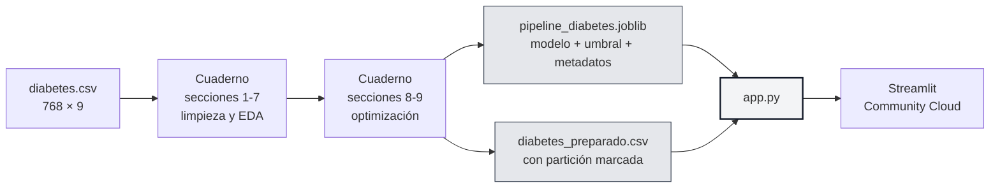
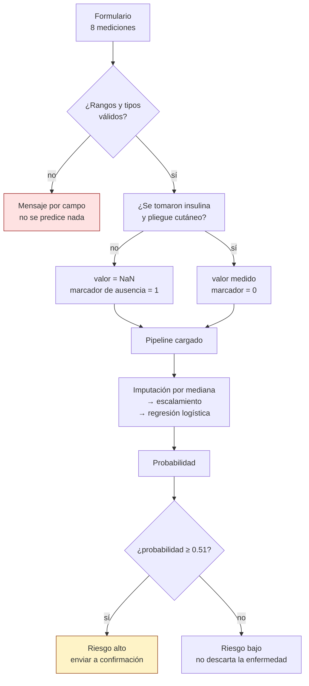
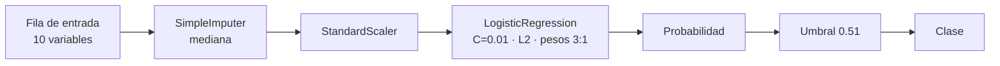

# Predicción de diabetes a partir de indicadores clínicos

Proyecto de aula de **Data Mining** · Universidad de la Costa (CUC) · Departamento de Ciencias de la Computación y Electrónica
Docente: José Escorcia-Gutiérrez, Ph.D. · Tercer corte — Actividad 1: integración y despliegue con Streamlit

**Integrantes:** Santiago Andrés Lozano

| | |
|---|---|
| **Aplicación** | _(pegar aquí la URL pública de Streamlit)_ |
| **Repositorio** | _(pegar aquí la URL de este repositorio)_ |
| **Datos** | [Pima Indians Diabetes Database](https://www.kaggle.com/datasets/uciml/pima-indians-diabetes-database) — NIDDK / UCI Machine Learning Repository |

> Clasificación binaria sobre 768 registros clínicos. El modelo se elige por su capacidad de **detectar los casos positivos**, no por su exactitud global, porque en un tamizaje un falso negativo cuesta mucho más que un falso positivo.

> [!WARNING]
> **Prototipo académico.** No sustituye una decisión profesional. El modelo deja sin detectar a 7 de cada 67 pacientes diabéticas del conjunto de prueba y se entrenó con una sola población. No debe usarse para decidir sobre ninguna persona real.

---

## Uso diario

```bash
# 1. Instalar dependencias
pip install -r requirements.txt

# 2. Levantar la aplicación
streamlit run app.py          # queda en http://localhost:8501
```

```bash
# Regenerar el modelo y los datos desde el cuaderno (solo si se cambia algo del modelado)
jupyter notebook notebook/Avance3_Prediccion_Diabetes_Santiago_Lozano.ipynb
# Ejecutar todas las celdas. Las secciones 10 y 12 vuelven a escribir:
#   modelo/pipeline_diabetes.joblib
#   datos/diabetes_preparado.csv
#   requirements.txt
```

> `requirements.txt` lo genera el propio cuaderno con las versiones de librería con las que creó el `.joblib`. Editarlo a mano desacopla los dos archivos y las predicciones pueden dejar de coincidir.

---

## Qué hay aquí

```
.
├── app.py                        Aplicación Streamlit (carga el modelo, nunca lo entrena)
├── requirements.txt              Generado por el cuaderno, con las versiones del entrenamiento
├── diabetes.csv                  Conjunto original, tal como se descarga
├── modelo/
│   └── pipeline_diabetes.joblib  Pipeline ajustado + umbral + metadatos del formulario
├── datos/
│   └── diabetes_preparado.csv    768 registros preparados, con la partición marcada
└── notebook/
    └── Avance3_…ipynb            Cuaderno completo: secciones 1-7 del segundo corte, 8-13 de este
```

---

## Cómo funciona



La aplicación **no entrena nada**: carga el pipeline ya ajustado y le pide predicciones. Las métricas que muestra las recalcula aplicando ese mismo pipeline sobre la partición de prueba, así que no pueden separarse de las del cuaderno.

### Flujo de una predicción



Los dos marcadores de ausencia no son un parche de la interfaz: el conjunto original no trae el examen de insulina en el 48.70 % de los registros ni el pliegue cutáneo en el 29.56 %, y el modelo se entrenó contemplando esa ausencia.

### El pipeline serializado



La imputación y el escalamiento viven **dentro** del pipeline, así que sus parámetros se aprendieron solo con los 576 registros de entrenamiento. Calcularlos sobre todo el conjunto habría sido una fuga de información.

---

## El modelo

Regresión logística con regularización L2 fuerte (`C = 0.01`) y ponderación de clases de 3 a 1 a favor de la clase positiva, operando en el umbral 0.51.

### Qué cambió en el tercer corte

| Métrica (conjunto de prueba, 192 registros) | Segundo corte | Tercer corte | |
|---|---|---|---|
| **Exhaustividad (clase 1)** — métrica principal | 0.687 | **0.896** | ▲ |
| Precisión (clase 1) | 0.597 | 0.561 | ▼ |
| F1 (clase 1) | 0.639 | **0.690** | ▲ |
| Exactitud | 0.729 | 0.719 | ▼ |
| AUC | 0.829 | 0.822 | ≈ |
| Brecha de generalización (F1) | 0.051 | **−0.002** | ▲ |
| **Pacientes diabéticas detectadas** (de 67) | 46 | **60** | ▲ |
| Falsos negativos | 21 | **7** | ▲ |
| Falsos positivos | 31 | 47 | ▼ |

**El intercambio fue deliberado:** 14 pacientes diabéticas más detectadas a cambio de 16 consultas de confirmación adicionales. El modelo nuevo es mejor **para un tamizaje**; es peor si lo que se busca es acertar el mayor número de veces.

### De dónde vino la mejora

| Se probó | Resultado |
|---|---|
| Imputación por vecinos más cercanos frente a la mediana | **No sirvió.** Mejora el F2 en 0.013 con una desviación de 0.073: cabe dentro del ruido. Se conservó la mediana. |
| Búsqueda de hiperparámetros (366 combinaciones en tres familias) | **De aquí vino todo.** Las tres familias eligieron modelos más simples y con más peso en la clase positiva. |
| Umbral de decisión, de 0.20 a 0.80 | **No era el problema.** Quedó en 0.51, donde ya estaba por defecto. Ajustada la ponderación de clases, el umbral no tenía nada que aportar. |

Detalle completo, con tablas y figuras, en las secciones 8 a 13 del cuaderno.

---

## Verificación

La guía pide comprobar tres situaciones. Están automatizadas en la **sección 11** del cuaderno y disponibles como botones en la pestaña «Predicción» de la aplicación.

| Caso | Qué comprueba | Resultado |
|---|---|---|
| ① Caso normal | El formulario predice con valores plausibles | Probabilidad y clase coherentes con el umbral |
| ② Entrada inválida | Glucosa, edad e IMC fuera de rango | Se rechaza por campo y **no** se calcula ninguna predicción |
| ③ Registro conocido del conjunto de prueba | Que la aplicación coincida con el cuaderno | Misma probabilidad hasta el sexto decimal |

El cuaderno recarga el `.joblib` desde el disco y compara con `assert`: si el archivo serializado no reprodujera las predicciones, la ejecución se detiene.

---

## Limitaciones

- Deja pasar **7 de 67** pacientes diabéticas y marca **47 de 125** sanas. Insuficiente para cualquier uso clínico.
- 768 registros, 192 de prueba: mover dos o tres pacientes desplaza las métricas varios puntos.
- Población única —mujeres mayores de 21 años de una comunidad indígena—, no extrapolable a otros grupos ni al contexto colombiano.
- Falta casi la mitad de los valores de insulina y cerca de un tercio del pliegue cutáneo.
- Los hiperparámetros se ajustaron sobre 576 registros, pocos para optimizar: parte de la ganancia podría no sostenerse con datos nuevos.
- Todo lo reportado son **asociaciones**, no relaciones de causa y efecto.

---

## Evaluación del uso de inteligencia artificial

**Herramienta:** Claude (Anthropic), versión web.

Los usos de los dos primeros cortes están documentados en el informe del segundo avance. Lo que sigue corresponde a este corte.

| | |
|---|---|
| **Propósito** | Interpretar la guía de la actividad, proponer la estrategia de optimización del modelo y construir la aplicación de despliegue sobre el cuaderno ya existente. |
| **Prompt principal** | «Lee la Actividad 1 del tercer corte y, con el cuaderno y el informe del segundo corte como punto de partida, continúa el proyecto según lo que pide ese documento: revisión del rendimiento, optimización si hace falta, serialización del pipeline y aplicación en Streamlit lista para desplegar.» |
| **Cómo se verificó** | Ninguna cifra del cuaderno, del README o de la aplicación se tomó de la herramienta. Todas se recalcularon ejecutando el cuaderno de principio a fin. Las 30 métricas del segundo informe se volvieron a comprobar con `assert` (sección 8.1), y la paridad entre el modelo serializado y el cuaderno también (sección 11). |
| **Problemas encontrados** | **(1)** La primera propuesta optimizaba el F2 de la clase positiva sin ninguna restricción. Al ejecutarla, el umbral resultante hundía la exactitud a 0.651 y marcaba como caso de riesgo a 64 de las 125 pacientes sanas: un modelo degenerado que además quedaba por debajo del piso de 0.70 que fija la guía. **(2)** La rejilla de hiperparámetros incluía una comparación entre penalización L1 y L2 mediante el parámetro `penalty`, que la versión instalada de scikit-learn tiene deprecado; al ejecutar el cuaderno aparecían advertencias y, lo más grave, el brazo L1 de la búsqueda se estaba resolviendo silenciosamente como L2, de modo que esa comparación no medía nada. |
| **Ajustes realizados** | **(1)** Se añadió al criterio de optimización la restricción de que la exactitud no baje de 0.70, el mismo piso de la guía, y el experimento sin restricción se conservó en la tabla de resultados como evidencia de por qué la restricción hacía falta. **(2)** Se eliminó el parámetro deprecado y la comparación L1 contra L2, dejando la penalización L2 por defecto, que además es la indicada ante las tres parejas de variables correlacionadas que el segundo corte había documentado. El cuaderno quedó ejecutándose sin una sola advertencia. |
| **Valoración** | Útil para estructurar el trabajo y para escribir el código de la aplicación. No fiable sin verificación: las dos decisiones metodológicas que había que corregir solo se detectaron al ejecutar y contrastar los resultados contra el enunciado de la actividad. El criterio de selección del modelo, el piso de exactitud y el alcance de cada entrega son decisiones propias. |

**Declaración de responsabilidad.** Revisé y verifiqué el contenido generado con apoyo de herramientas de inteligencia artificial. Identifiqué y corregí los errores encontrados, comprendo el código entregado y asumo la responsabilidad académica por la totalidad del cuaderno, la aplicación y este documento.

---

## Referencias de los datos

Smith, J. W., Everhart, J. E., Dickson, W. C., Knowler, W. C., & Johannes, R. S. (1988). *Using the ADAP learning algorithm to forecast the onset of diabetes mellitus.* Proceedings of the Annual Symposium on Computer Application in Medical Care, 261–265.

Pedregosa, F., et al. (2011). *Scikit-learn: Machine learning in Python.* Journal of Machine Learning Research, 12, 2825–2830.
